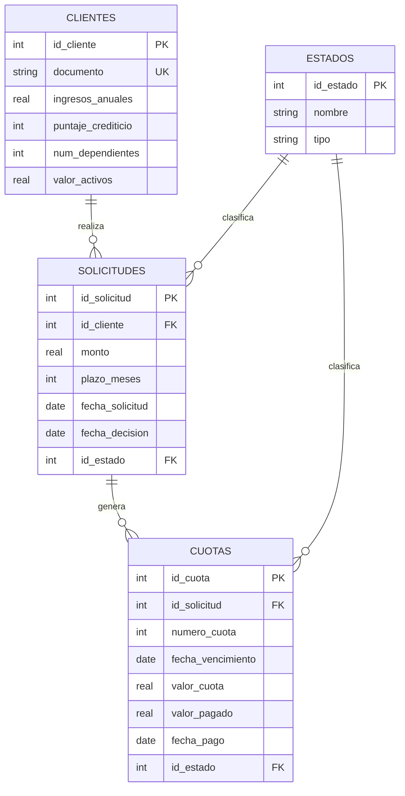

# Microcréditos: módulo operativo y dashboard

Proyecto final de Gerencia Estratégica de TI. Prototipo funcional que registra solicitudes
de microcrédito, decisiones, desembolsos y pagos de cuotas, y los convierte en indicadores
clave (KPIs) para la toma de decisiones gerenciales.

**Caso de estudio:** Control de Solicitudes y Cobranza de Microcréditos.
**Tecnología:** Python, Streamlit, SQLite, pandas y plotly.

<!-- Cuando tengas las capturas, guárdalas en docs/ y quita los comentarios de estas líneas:


-->

## Qué hace

- **Módulo operativo** (`app.py`): formularios para registrar clientes, solicitudes de crédito,
  decisiones (aprobar o rechazar), desembolsos (que generan las cuotas) y pagos de cuotas.
- **Dashboard gerencial** (`dashboard.py`): tarjetas con los KPIs, gráficos de tendencias y tabla
  detallada de solicitudes, con filtro por periodo, estado y documento.
- **Validación** (`kpis.py`): recalcula los KPIs de forma independiente con pandas y comprueba
  que coinciden con los del dashboard.

## KPIs

| KPI | Fórmula | Meta | Decisión que apoya |
| --- | --- | --- | --- |
| % de créditos morosos | (Créditos desembolsados con alguna cuota sin pagar y más de 30 días vencida ÷ Créditos desembolsados) × 100 | ≤ 8 % | Endurecer o flexibilizar la política de aprobación y priorizar la cobranza |
| Tiempo promedio de aprobación (días) | Promedio de (fecha de decisión − fecha de solicitud) en solicitudes decididas | ≤ 2 días | Reasignar analistas o automatizar pasos del estudio de crédito |
| Recuperación de cartera exigible (%) | (Pagos recibidos sobre cuotas ya vencidas ÷ Valor de las cuotas ya vencidas) × 100 | ≥ 85 % | Evaluar la salud de la cartera y ajustar plazos o tasas |

**Nota sobre el tercer KPI.** La definición original era *monto recuperado vs. otorgado*
(pagos recibidos ÷ monto total desembolsado). Con una cartera joven esa razón queda baja de forma
estructural, porque el denominador incluye cuotas que todavía no vencen. Por eso el dashboard mide
la recuperación contra lo exigible a la fecha y muestra la razón original como referencia debajo
de la tarjeta. Para volver a la fórmula original, cambiar `FORMULA_RECUPERACION` a `"otorgado"`
al inicio de `dashboard.py`.

## Datos reales y simulados

El CSV de Kaggle ([Loan Approval Prediction Dataset](https://www.kaggle.com/datasets/architsharma01/loan-approval-predictiondataset))
trae solo datos del solicitante y el resultado de la solicitud. No trae fechas ni pagos, así que
parte de los datos son **simulados**, y esto debe tenerse presente al interpretar los KPIs.

| Origen | Datos |
| --- | --- |
| Reales (CSV) | Ingresos anuales, puntaje crediticio, número de dependientes, activos, monto, plazo y resultado (aprobada o rechazada) |
| Simulados (`db/load_csv.py`) | Documento del cliente, fechas de solicitud y de decisión, cuotas y sus pagos |

Supuestos de la carga:

- Se toma una **muestra de 1.000 registros** del CSV (4.269 filas), con la misma proporción de aprobados
  y rechazados y una semilla fija (`42`), para cumplir el rango de 200 a 1.000 registros de la guía.
- Se limpian los espacios sobrantes de encabezados y valores, y un valor negativo en activos residenciales se lleva a 0.
- `loan_term` (2 a 20) se interpreta como **meses**.
- Las solicitudes se reparten en los últimos 18 meses, y cada decisión toma al menos 1 día (unos 2 en promedio).
- Las solicitudes aprobadas del CSV quedan como *Desembolsada*.
- Cuotas fijas, sin interés, una cada 30 días desde el desembolso.
- La probabilidad de que un cliente deje de pagar depende de su puntaje crediticio: es mayor mientras más bajo.
- Los montos se muestran en las unidades monetarias del dataset.

## Modelo de datos

Cuatro tablas: `clientes` y `estados` (maestras), `solicitudes` y `cuotas` (transaccionales).
El esquema completo está en `db/schema.sql`.



Estados de solicitud: Pendiente, Aprobada, Rechazada, Desembolsada.
Estados de cuota: Pendiente, Pagada, Vencida.

## Instalación

Requiere **Python 3.10 o superior**.

```bash
python -m venv .venv
source .venv/bin/activate        # En Windows (PowerShell): .venv\Scripts\Activate.ps1
pip install -r requirements.txt
```

## Ejecución

El repositorio ya incluye la base de datos poblada (`db/microcreditos.db`), así que basta con:

```bash
streamlit run app.py
```

Se abre en el navegador (`http://localhost:8501`). El menú lateral permite pasar del
**Módulo operativo** al **Dashboard gerencial**.

Para regenerar la base desde cero a partir del CSV (debe estar en `data/raw/loan_approval_dataset.csv`):

```bash
python db/load_csv.py --reset
```

> Las fechas simuladas se calculan respecto al día en que se ejecuta el script, así que los KPIs
> varían ligeramente entre una ejecución y otra.

## Uso del módulo operativo

El flujo de una operación completa es:

1. **Clientes:** registrar el cliente.
2. **Solicitudes:** crear su solicitud (queda *Pendiente*).
3. **Decisión y desembolso:** aprobar o rechazar; si se aprueba, desembolsar para generar las cuotas.
4. **Pagos de cuotas:** registrar el pago de cada cuota (siempre por el valor completo).
5. **Verificación:** ver los totales y los últimos registros, junto con los datos del CSV.

El dashboard refleja cada cambio: al volver a él desde el menú, las tarjetas y los gráficos se recalculan.

## Validación de métricas

```bash
python kpis.py
```

El script calcula cada KPI con el código del dashboard y de forma independiente con pandas, para todo
el historial y para los últimos 6 meses, e imprime una tabla con el resultado de cada comparación.
Termina con código de error si alguna métrica no coincide.

**Prueba de punta a punta (E2E).** Se registra un cliente, una solicitud, su aprobación, su desembolso
y el pago de una cuota en el módulo operativo, y se verifica en el dashboard que suben las solicitudes
del periodo, el monto otorgado y el monto recuperado.

## Estructura del repositorio

```text
├── README.md
├── requirements.txt
├── app.py              # módulo operativo y menú de navegación
├── dashboard.py        # página del dashboard gerencial
├── kpis.py             # cálculo de KPIs, series y validación
├── db/
│   ├── schema.sql      # tablas del DER
│   ├── init_db.py      # crea microcreditos.db
│   ├── load_csv.py     # importa el CSV y simula fechas y cuotas
│   └── microcreditos.db
└── data/
    └── raw/
        └── loan_approval_dataset.csv
```

## Limitaciones

- SQLite es un archivo local pensado para un solo usuario: no hay autenticación ni control de concurrencia.
- Los pagos se registran siempre por el valor completo de la cuota, y las cuotas no incluyen interés.
- La fecha de desembolso no se guarda como columna: se deduce de la fecha de la primera cuota.
- Fechas, cuotas y pagos históricos son simulados, por lo que los KPIs ilustran el funcionamiento del
  sistema y no la realidad de una entidad.
- Un despliegue real en la nube necesitaría disco persistente o una base como PostgreSQL, porque en
  varios planes gratuitos el archivo SQLite se pierde al reiniciar el servicio.

## Estado del proyecto

- [x] Semana 1: KPIs, DER y esquema de base de datos
- [x] Semana 2: módulo operativo en Streamlit y carga del CSV
- [x] Semana 3: dashboard y validación de métricas
- [ ] Semana 4: costos, documentación y sustentación (prueba E2E y README listos)